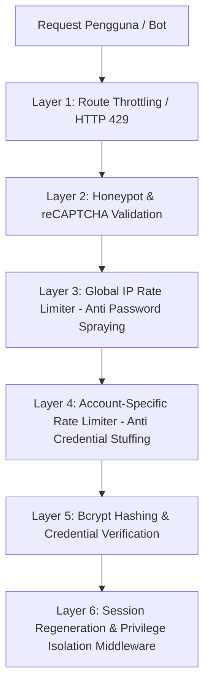

# 🛡️ Dokumentasi Implementasi Keamanan Sistem (Security Implementation)
**PFE Monitoring Control System — B. Braun Medical Indonesia**

Dokumen ini menjelaskan seluruh arsitektur, lapisan pertahanan, mekanisme teknis, dan cara kerja fitur keamanan yang diimplementasikan pada aplikasi **PFE Monitoring Control System**.

---

## Daftar Isi
1. [Ringkasan Arsitektur Keamanan (Defense-in-Depth)](#1-ringkasan-arsitektur-keamanan-defense-in-depth)
2. [Proteksi Brute-Force & Flooding pada Login](#2-proteksi-brute-force--flooding-pada-login)
3. [Keamanan Verifikasi PIN Inspeksi Lapangan](#3-keamanan-verifikasi-pin-inspeksi-lapangan)
4. [Proteksi Bot (Honeypot & Google reCAPTCHA)](#4-proteksi-bot-honeypot--google-recaptcha)
5. [Isolasi Hak Akses & Sesi (Privilege & Session Separation)](#5-isolasi-hak-akses--sesi-privilege--session-separation)
6. [Kriptografi & URL Bertanda Tangan (Signed URLs)](#6-kriptografi--url-bertanda-tangan-signed-urls)
7. [Integritas Data Lapangan (Anti-Fraud & Geofencing)](#7-integritas-data-lapangan-anti-fraud--geofencing)
8. [Audit Trail & Activity Logging](#8-audit-trail--activity-logging)
9. [Matriks Parameter Keamanan](#9-matriks-parameter-keamanan)

---

## 1. Ringkasan Arsitektur Keamanan (Defense-in-Depth)

Aplikasi menerapkan konsep **Pertahanan Berlapis (*Defense-in-Depth*)**, di mana setiap celah potensial dilindungi oleh lebih dari satu mekanisme keamanan:



---

## 2. Proteksi Brute-Force & Flooding pada Login

Pada halaman login utama ([AuthController.php](file:///c:/laragon/www/APARB.Braun/app/Http/Controllers/AuthController.php)), diterapkan proteksi 3 lapis untuk mengantisipasi berbagai jenis serangan siber:

### A. Lapis Kecepatan Request (Route Throttling)
* **Lokasi**: [routes/web.php](file:///c:/laragon/www/APARB.Braun/routes/web.php#L34) (`middleware('throttle:20,1')`)
* **Cara Kerja**:
  Membatasi maksimal **20 request per menit per IP** ke endpoint `POST /login`.
* **Tujuan**:
  Mencegah bot otomatis yang mengirimkan ratusan request per detik. Jika batas terlampaui, web server langsung mengembalikan status `HTTP 429 Too Many Requests` tanpa menjalankan proses database atau perhitungan hashing kata sandi (`Bcrypt`) yang berat di CPU.

### B. Lapis Akun Spesifik (Anti-Brute Force Akun Tunggal)
* **Kunci Throttle**: `email + IP Address`
* **Ambang Batas**: Maksimal **5 kali percobaan gagal**.
* **Durasi Blokir**: **10 menit** (600 detik).
* **Pesan Error**: *"Akun Anda diblokir sementara karena terlalu banyak percobaan masuk."*
* **Cara Kerja**:
  Jika penyerang menargetkan satu akun tertentu (misal: `admin@bbraun.com`) dan gagal 5 kali berturut-turut, maka kombinasi akun tersebut dari IP pengakses akan dibekukan selama 10 menit.

### C. Lapis Global IP (Anti-Password Spraying)
* **Kunci Throttle**: `login-ip:{ip_address}`
* **Ambang Batas**: Maksimal **10 kali percobaan gagal total** (akumulatif dari semua akun).
* **Durasi Blokir**: **10 menit** (600 detik).
* **Pesan Error**: *"Akses masuk diblokir sementara karena terlalu banyak percobaan gagal dari perangkat ini."*
* **Cara Kerja**:
  Mendeteksi serangan *Password Spraying* (bot yang mencoba satu kata sandi umum ke puluhan akun berbeda agar tidak terkena limit akun 5x). Begitu total kegagalan dari IP tersebut mencapai 10 kali, seluruh IP perangkat langsung diblokir total untuk semua akun.

### D. Pencegahan Kebocoran Informasi (Generic Error Handling)
Sistem **tidak menampilkan hitungan mundur** (*countdown* detik/menit sisa blokir) pada pesan error. Hal ini mengikuti standar OWASP agar penyerang tidak dapat mengetahui waktu pasti pembukaan blokir untuk menjadwalkan serangan berikutnya.

---

## 3. Keamanan Verifikasi PIN Inspeksi Lapangan

Petugas yang melakukan inspeksi di lapangan memindai QR Code APAR dan memverifikasi identitas menggunakan **4 Digit PIN** ([ScanController.php](file:///c:/laragon/www/APARB.Braun/app/Http/Controllers/ScanController.php)).

### A. Kunci Throttle Global per Perangkat
* **Kunci Throttle**: `verify-pin:{ip_address}`
* **Ambang Batas**: Maksimal **5 kali percobaan salah**.
* **Durasi Blokir**: **10 menit** (600 detik).
* **Pesan Error**: *"Akses verifikasi PIN diblokir sementara karena terlalu banyak percobaan salah."*
* **Mengapa Berbasis IP Global (Bukan per APAR ID)?**
  Jika kunci menyertakan ID APAR, penyerang yang salah 5x di APAR A bisa pindah memindai APAR B untuk mencoba 5x lagi. Dengan kunci berbasis IP, pemblokiran 10 menit berlaku serentak di seluruh APAR.

### B. Hashing PIN
PIN disimpan di database dalam bentuk terenkripsi satu arah menggunakan **Bcrypt** (`Hash::make()`), bukan teks polos (*plaintext*).

---

## 4. Proteksi Bot (Honeypot & Google reCAPTCHA)

Untuk membedakan pengakses manusia dengan bot / skrip otomatis:

### A. Honeypot Trap
* Pada form login terdapat field input tersembunyi: `<input name="_contact_number" class="hidden">`.
* User tidak melihat dan tidak akan mengisi field ini.
* Bot perayap (*crawler/spammer*) otomatis mengisi semua input form yang ditemukan.
* Jika field `_contact_number` terisi nilai apa pun, request langsung digagalkan seketika.

### B. Google reCAPTCHA v2
* Divalidasi melalui rule [Recaptcha.php](file:///c:/laragon/www/APARB.Braun/app/Rules/Recaptcha.php) dengan memanggil Google Siteverify API.
* Mencegah pengiriman form otomatis tanpa interaksi manusia.

---

## 5. Isolasi Hak Akses & Sesi (Privilege & Session Separation)

Aplikasi memisahkan secara ketat antara sesi **Inspeksi Lapangan (PIN)** dan sesi **Manajemen Utama (Web Login)**.

### A. Middleware `RestrictPinLogin`
* **Lokasi**: [RestrictPinLogin.php](file:///c:/laragon/www/APARB.Braun/app/Http/Middleware/RestrictPinLogin.php)
* **Cara Kerja**:
  Petugas yang masuk melalui verifikasi PIN saat memindai QR Code hanya diberikan izin mengakses modul inspeksi (`/inspeksi/*`). Jika mereka mencoba mengakses dashboard admin, master data, manajemen pengguna, atau laporan:
  1. Sesi pengguna langsung dimusnahkan (`Auth::logout()`, `session()->invalidate()`).
  2. CSRF Token di-regenerasi ulang (`session()->regenerateToken()`).
  3. Pengguna dilempar keluar dengan peringatan keamanan.

### B. Auto-Session Logout Saat Scan Ulang
* Pada [ScanController::index](file:///c:/laragon/www/APARB.Braun/app/Http/Controllers/ScanController.php#L22):
  Setiap kali halaman scan dibuka dari luar sistem (bukan dari dashboard), sesi inspeksi sebelumnya otomatis di-*logout* dan dibersihkan. Hal ini mencegah petugas lain atau orang asing menggunakan sesi yang tertinggal di peramban.

### C. Middleware `PreventBackHistory`
* **Lokasi**: [PreventBackHistory.php](file:///c:/laragon/www/APARB.Braun/app/Http/Middleware/PreventBackHistory.php)
* Menambahkan header HTTP:
  ```http
  Cache-Control: nocache, no-store, max-age=0, must-revalidate
  Pragma: no-cache
  Expires: Sat, 01 Jan 1990 00:00:00 GMT
  ```
* **Fungsi**: Mematikan fitur *back-forward cache* di browser. Setelah pengguna logout, menekan tombol "Back" di browser tidak akan menampilkan kembali formulir atau data sensitif yang tersimpan di cache.

---

## 6. Kriptografi & URL Bertanda Tangan (Signed URLs)

Untuk fitur yang melibatkan tautan via email (Setup Akun & Lupa Password):
* Menggunakan fitur **Laravel Signed URLs** (`middleware('signed')`).
* URL memiliki parameter signature berbasis `HMAC-SHA256` dengan kunci aplikasi (`APP_KEY`).
* Memiliki masa kedaluwarsa waktu (*expiration timestamp*).
* Parameter URL yang dimanipulasi sekecil apa pun akan menghasilkan error `403 Invalid Signature`.

---

## 7. Integritas Data Lapangan (Anti-Fraud & Geofencing)

Untuk memastikan bahwa inspeksi benar-benar dilakukan secara fisik di lokasi APAR:

1. **Geofencing GPS Real-Time**:
   Sistem membaca koordinat GPS perangkat petugas dan memvalidasi radius jarak fisik terhadap titik koordinat APAR/gedung.
2. **Watermarking Foto Otomatis**:
   Foto bukti fisik yang diambil saat inspeksi langsung dibubuhi *watermark* permanen di server yang memuat:
   * Kode APAR
   * Nama Petugas
   * Tanggal & Jam (Presisi Detik)
   * Titik Koordinat GPS
3. **Anti-Inspect Script**:
   Pada tampilan mobile/inspeksi, script pelindung mematikan klik kanan (*context menu*) dan *shortcut* keyboard developer tools (`F12`, `Ctrl+Shift+I`, `Ctrl+U`) untuk mencegah manipulasi form secara kasual.

---

## 8. Audit Trail & Activity Logging

* Menggunakan pustaka **Spatie Activitylog** pada model-model inti (`User`, `Apar`, `Inspeksi`).
* Setiap operasi penting (Create, Update, Delete) tercatat ke tabel database:
  * ID dan Nama pengguna yang melakukan aksi
  * Atribut data sebelum dan sesudah perubahan (*dirty attributes*)
  * Alamat IP dan waktu kejadian

---

## 9. Matriks Parameter Keamanan

| Modul / Komponen | Kunci Throttle | Batas Percobaan | Durasi Blokir | Tindakan / Respon |
| :--- | :--- | :--- | :--- | :--- |
| **Login (Per Akun)** | `email` + `IP` | 5 kali gagal | 10 Menit (600s) | Kunci akun sementara untuk IP terkait |
| **Login (Global IP)** | `login-ip:{ip}` | 10 kali gagal | 10 Menit (600s) | Blokir seluruh akses login dari IP terkait |
| **Login (HTTP Traffic)** | IP Address | 20 request/menit | 1 Menit (Rolling) | HTTP 429 Too Many Requests |
| **Honeypot Form** | Field `_contact_number` | 1 kali terdeteksi | Instan | Ditolak seketika (anggap Bot) |
| **PIN Verifikasi APAR** | `verify-pin:{ip}` | 5 kali gagal | 10 Menit (600s) | Blokir input PIN di semua APAR |
| **Sesi PIN Inspeksi** | `session('is_pin_login')` | Akses rute non-inspeksi | Instan | Sesi dimusnahkan, force logout |
| **Reset / Setup Password** | Signed URL (HMAC) | 1 signature valid | Waktu terbatas | HTTP 403 Forbidden jika dimanipulasi |

---
*Dokumen ini diperbarui secara berkala mengikuti arsitektur keamanan aktif pada proyek APARB.Braun.*
